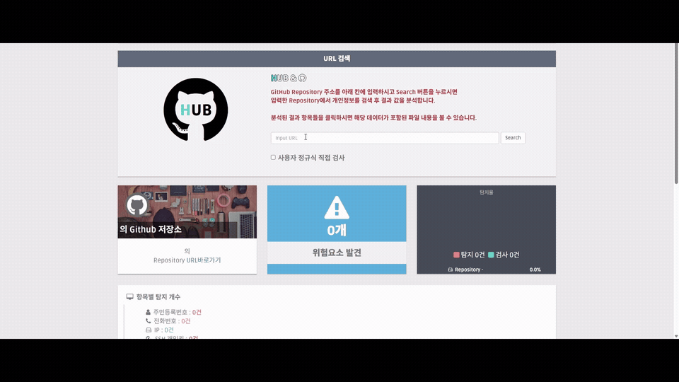
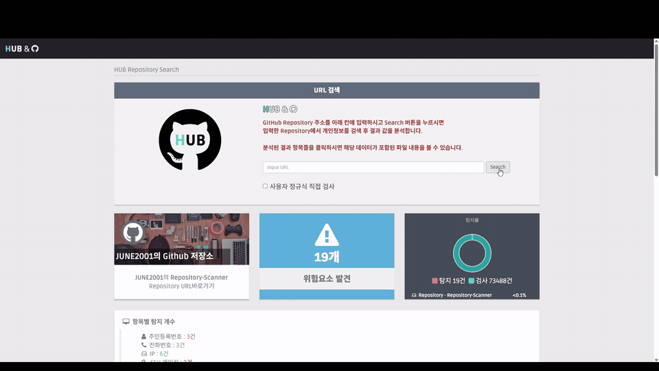

# HUB Repository Scanner

HUB Repository Scanner는 공개 GitHub 저장소의 소스 파일을 검사해 개인정보와 인증정보로 의심되는 문자열을 찾아주는 Flask 기반 웹 애플리케이션입니다.

## 주요 기능

- GitHub 저장소 URL 입력 및 기본 브랜치 자동 확인
- GitHub API를 이용한 전체 파일 목록 조회
- 파일별 탐지 결과와 원본 경로 표시
- 탐지 항목을 클릭해 해당 소스 파일 내용 확인
- 저장소 전체 검사량과 탐지 개수 시각화

## 동작 화면

### GitHub 저장소 탐색

검사할 GitHub 저장소 주소를 입력하고 저장소의 소스 파일을 탐색하는 과정입니다.



### 개인정보 탐지 결과

탐색이 끝난 후 개인정보와 인증정보 의심 항목이 종류별로 표시되는 화면입니다. 결과 행을 선택하면 해당 문자열이 발견된 파일 내용도 확인할 수 있습니다.



## 탐지 항목

| 항목 | 탐지 예시 | 비고 |
|---|---|---|
| 주민등록번호 형식 | `NNNNNN-NNNNNNN` | 숫자 6자리-7자리 형식 |
| 휴대전화 번호 | `010-NNNN-NNNN`, `010NNNNNNNN` | 010으로 시작하는 두 형식 |
| IPv4 주소 | `192.0.2.10` | IPv4 범위 검사 포함 |
| SSH 개인키 | `BEGIN OPENSSH PRIVATE KEY` 등 | OpenSSH, RSA, EC, DSA 헤더 탐지 |
| OpenAI API 키 | `sk-...`, `sk-proj-...`, `sk-svcacct-...` | 화면에는 일부만 남기고 마스킹 |

## 요구사항

- Windows, macOS 또는 Linux
- Python 3.10 이상 권장

## 설치 및 실행

### Windows PowerShell

```powershell
python -m venv .venv
.\.venv\Scripts\python.exe -m pip install -r requirements.txt
.\.venv\Scripts\python.exe app.py
```

가상환경 활성화 과정 없이 `.venv` 안의 Python을 직접 실행합니다.

### macOS 또는 Linux

```bash
python3 -m venv .venv
./.venv/bin/python -m pip install -r requirements.txt
./.venv/bin/python app.py
```

서버가 시작되면 브라우저에서 다음 주소를 엽니다.

```text
http://127.0.0.1:5000
```

## 사용 방법

1. GitHub에서 검사할 공개 저장소를 엽니다.
2. 저장소 URL을 복사합니다.
3. HUB Repository Scanner의 입력란에 URL을 붙여 넣습니다.
4. `Search` 버튼을 누릅니다.
5. 탐지 결과 표에서 항목을 클릭하면 해당 파일 내용을 확인할 수 있습니다.

입력 주소에는 사용자 이름뿐 아니라 저장소 이름까지 포함되어야 합니다.

## 동작 방식

1. 입력 URL이 `github.com/소유자/저장소` 형식인지 확인합니다.
2. GitHub API에서 저장소의 기본 브랜치와 파일 트리를 조회합니다.
3. 1MB 이하의 파일을 `raw.githubusercontent.com`에서 내려받습니다.
4. 바이너리로 판단되는 파일을 제외하고 텍스트를 정규식으로 검사합니다.
5. 항목별 탐지 문자열과 파일 경로를 결과 화면에 표시합니다.
